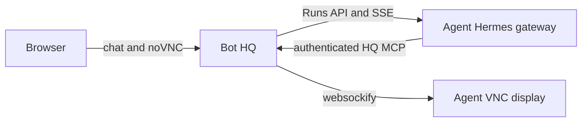

<p align="center">
  
</p>

<p align="center">
  Chat with remote Hermes Agents, watch their screens, and take over when needed.
</p>

<p align="center">
  
  
  
</p>

<p align="center">
  <picture>
    <source media="(prefers-color-scheme: dark)" srcset="assets/screenshots/chat-dark.png">
    
  </picture>
</p>

## Run locally

Use Node.js 22.12 or newer and npm. Copy `.env.example` to `.env` and set a
random `SESSION_SECRET`. For loopback development, set `DEV_LOGIN=1`.

```sh
npm ci
npm run dev
```

Open `http://localhost:5173`, sign in and register each Agent under
**Engine → Agent connection**. The [registration guide](docs/remote-agents.md)
covers Hermes, VNC, Chrome DevTools, Agent-to-HQ MCP and integration tests.

For the built app, run `npm run build`, set `APP_URL` to the built app's
origin, and run `npm start`. With dev login disabled, run
`bash scripts/sign-in-link.sh you@example.com` on the Bot HQ host to generate a
one-time sign-in link. `scripts/pack.sh` builds an archive, and
`scripts/install-on-computer.sh` unpacks it into `HQ_INSTALL_DIR`.

The [Atlas runbook](docs/atlas-deploy.md) covers the dedicated VM, release,
tailnet grants and backup checks.

## Gmail push for Tyler Personal

1. In the Google Cloud project that issued the existing Owner Gmail OAuth
   client, enable the Gmail and Cloud Pub/Sub APIs. Create a Pub/Sub topic and
   grant **Pub/Sub Publisher** on that topic to
   `gmail-api-push@system.gserviceaccount.com`. [Gmail push setup](https://developers.google.com/workspace/gmail/api/guides/push)
2. Create a dedicated **Pull** subscription on that topic. Enable exponential
   backoff for retries. Create a service account with **Pub/Sub Subscriber** on
   the subscription. Save its JSON key outside the repository, readable only by
   the Bot HQ service user. Bot HQ connects outbound with streaming pull.
3. Keep the [existing Tyler Personal pairing and Owner Gmail grant](docs/atlas-deploy.md#tylers-private-personal-assistant).
   Configure the following values in the Bot HQ service environment. Use short
   topic and subscription names from the same project.

   ```dotenv
   HQ_GMAIL_PUSH_GCP_PROJECT=my-gmail-project
   HQ_GMAIL_PUSH_TOPIC=gmail-inbox
   HQ_GMAIL_PUSH_SUBSCRIPTION=bot-hq-gmail
   HQ_GMAIL_PUSH_CREDENTIALS=/absolute/path/to/pubsub-service-account.json
   ```

4. Wire #585 at the marked import in `server/src/index.ts` and configure the
   Tyler Personal event routine with the exact name `Gmail new mail`. Event
   ingress must accept `refs: { messageId }`, persist and deduplicate accepted
   events by `event_id`, and allow this routine through Tyler Personal's turn
   gate. Restart Bot HQ and send a test message. Check for a single routine
   event with the sender, subject and Gmail message ID.

Run one streaming worker for this subscription and keep its Bot HQ SQLite data
directory across restarts. The first watch starts at the current mailbox
position. Daily renewal and restarts reconcile from the saved position. If
Gmail has expired that position, the worker scans all Inbox pages for the last
seven days and catches up changes made during the scan. It stores message IDs
and the history position. The worker fetches sender and subject headers in
[Gmail batches](https://developers.google.com/workspace/gmail/api/guides/batch).

## How it works



Hermes owns the Agent's persona, memory and model sign-in. Bot HQ owns chat,
routines, tasks and the delivery Library. Configure `XAI_API_KEY` for voice
and X research. Composio stays disabled.

The [upstream architecture notes](docs/ARCHITECTURE.md) describe the earlier
shared-computer implementation.

## License

MIT. Continued from [Bot HQ](https://github.com/nickvasilescu/bot-hq).
